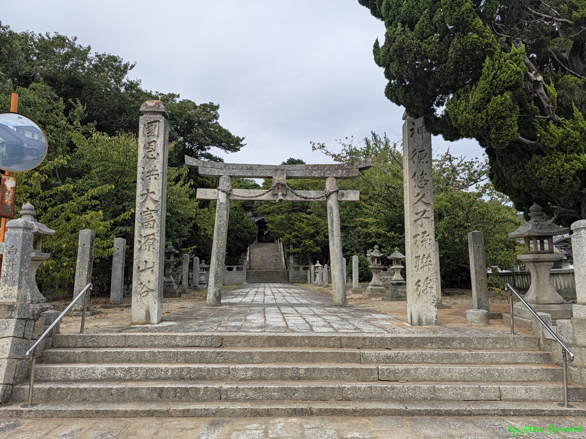
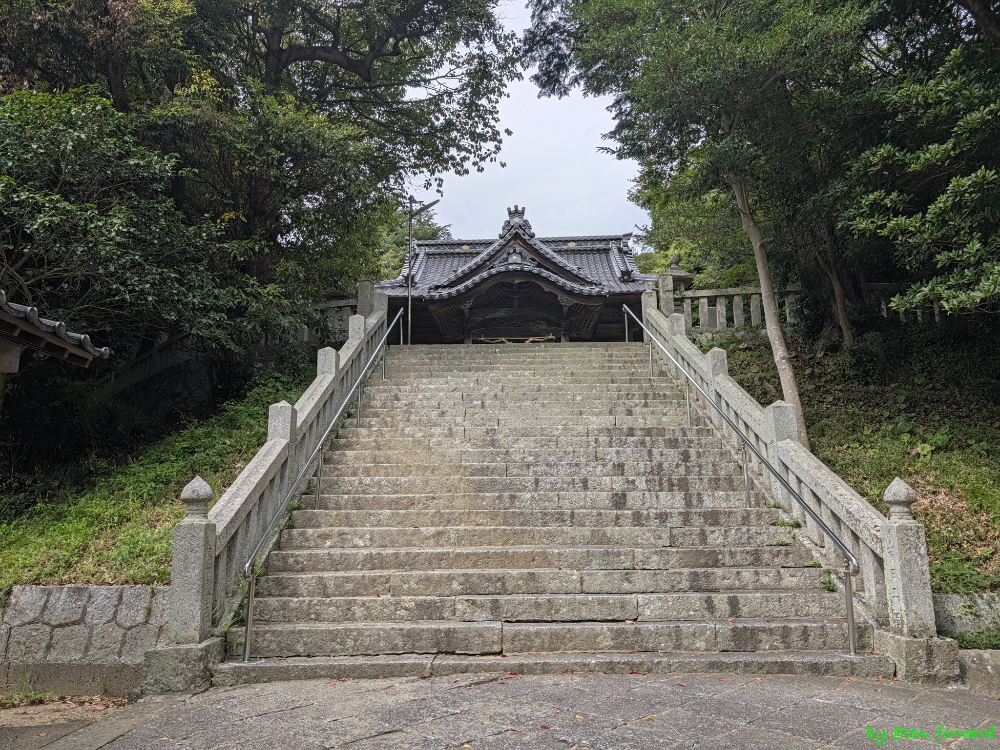
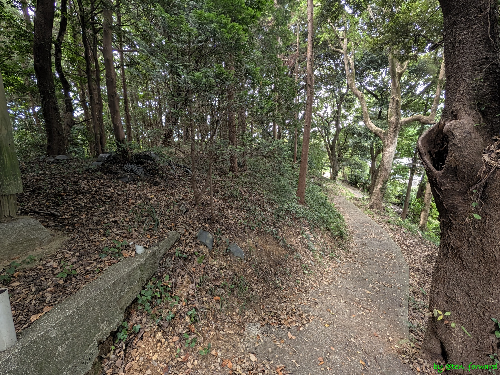
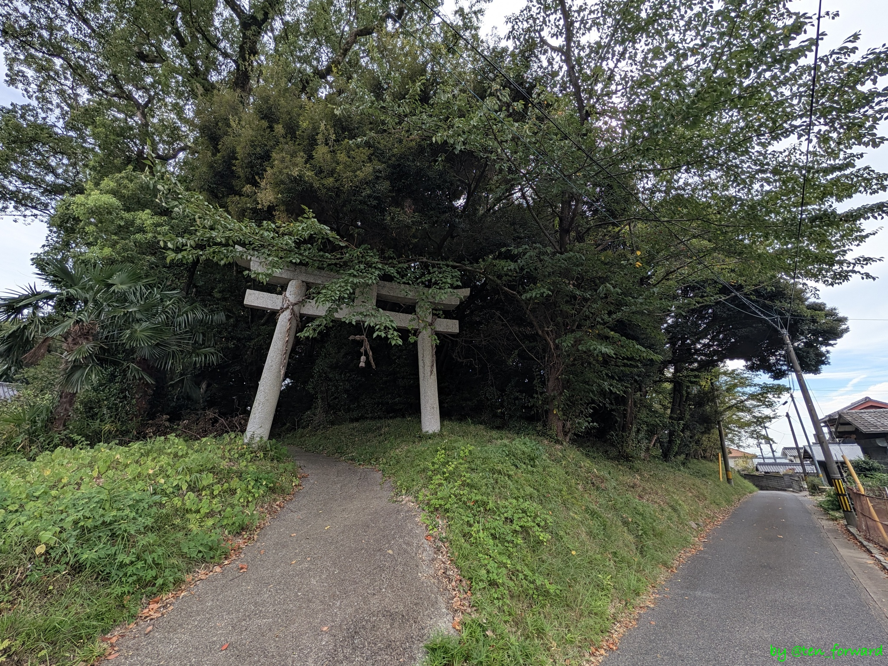
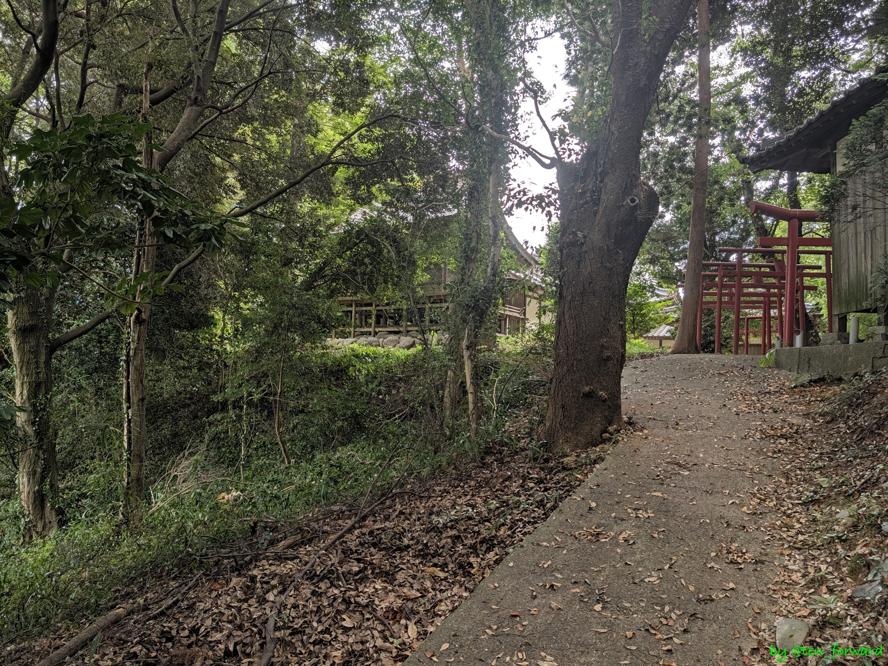
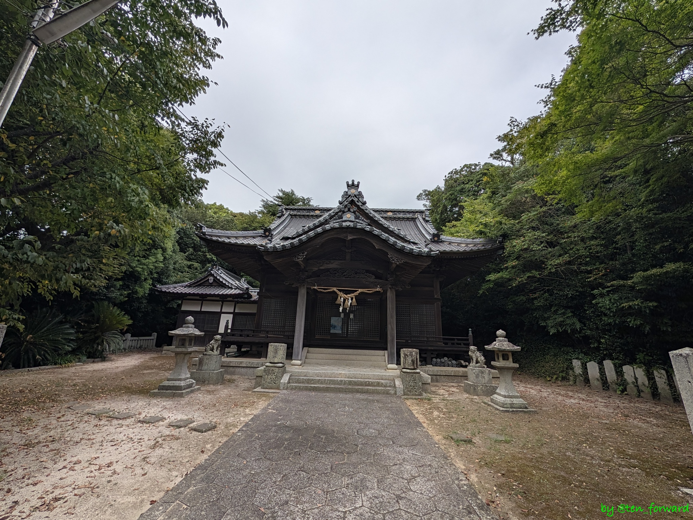
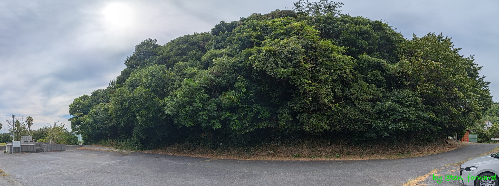
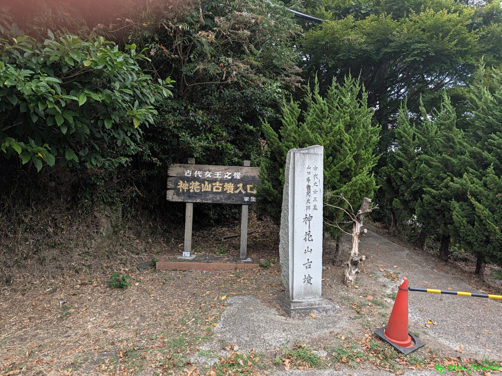

[柳井茶臼山古墳](/post/2026-08-28_yanaichausuyama/)を見たあとは、車で 20 分ほどの平生町にある白鳥古墳へ。

## 白鳥古墳

全長 120m ほどの 3 段築成の前方後円墳で、後円部墳頂には白鳥神社の本殿があります。

訪れると、なかなか前方後円墳であることを感じることは難しいのですが、それでも後円部に上がり前方部の方を見ると、くびれを感じることができたりします。

## 神花山古墳

白鳥古墳に行く途中の道脇で見つけた神花山（じんがやま）古墳にも立ち寄ってみました。全長は 30m ほどの前方後円墳とのことです。

が、墳頂に登る道に「立入禁止」の案内が… (>_<) 時間も夕方になってましたし、車を返す時間も迫ってましたので、脇から見てこの日は古墳を後にしました。

